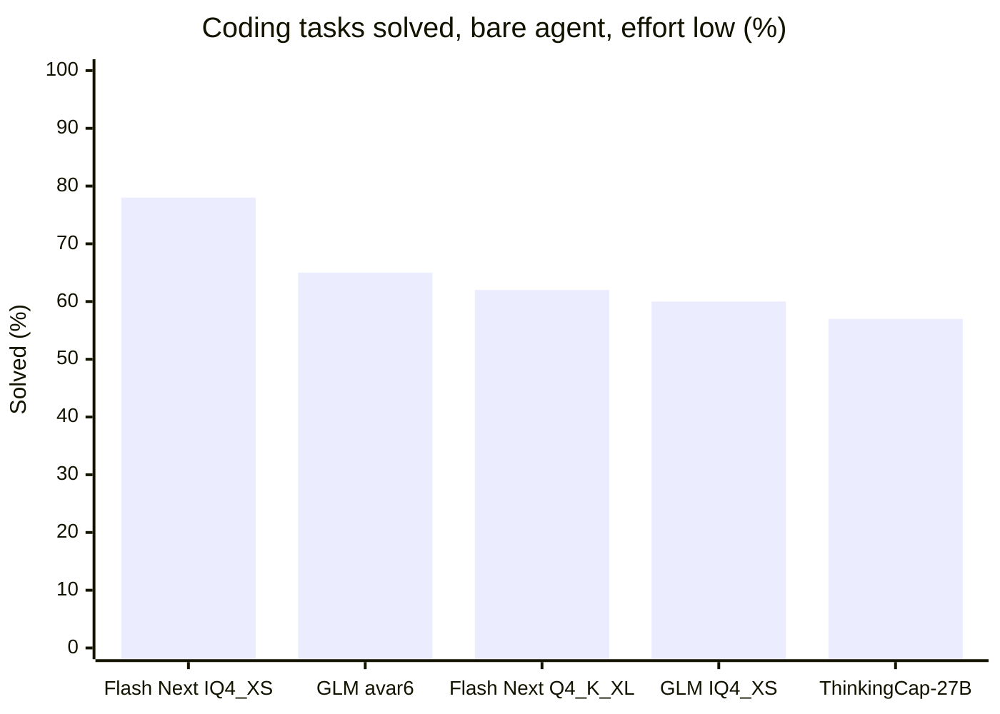
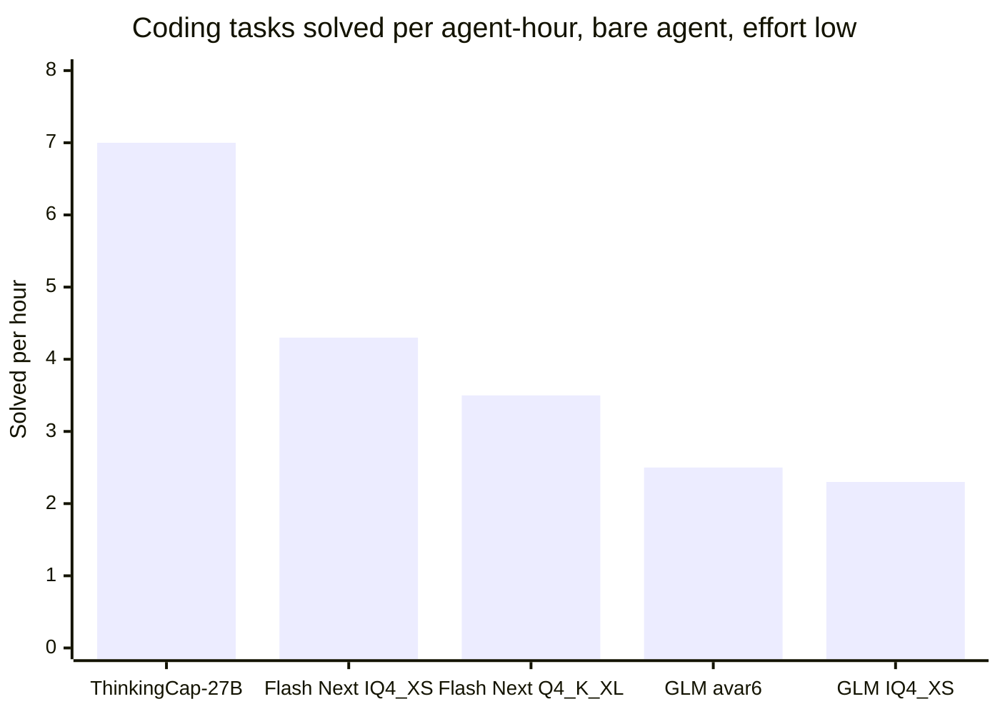
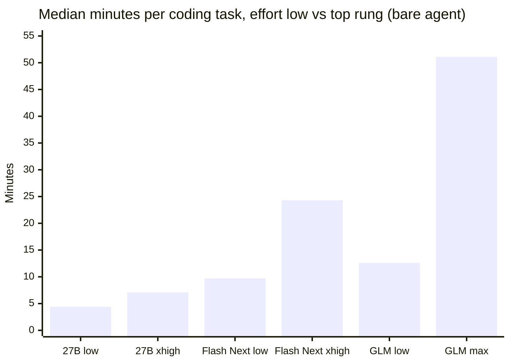
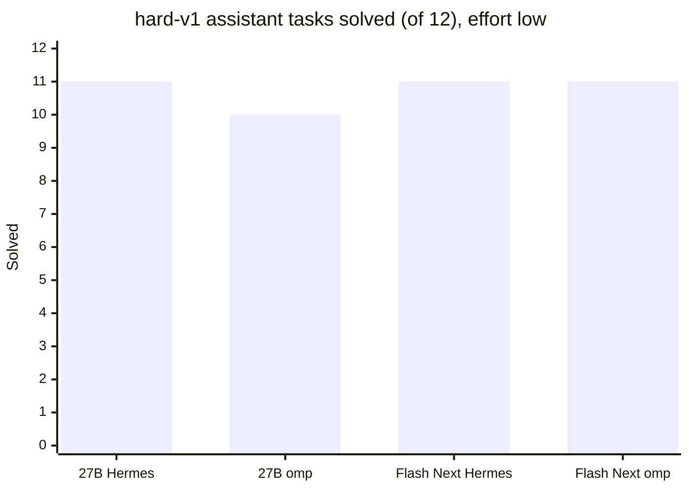

# What three local models got done as agents: club-3090 fixes, desk tasks, two harnesses, two effort levels

In #1626, @henrykrinkle01 asked whether the club's benches say anything about the model plus harness you work with, and the maintainer asked for a 2×2: effort low vs the top rung, bare agent vs omp. I ran that 2×2 on three models served from this repo, then gave two of them a set of non-coding desk tasks. Below: the results, where each model was strong or weak, and the settings I'd use now.

Rig: 2× RTX 5090, TR PRO 3975WX, 256 GB RAM. About 550 agent runs over three and a half days.

## What the club already measures, and the gap

The repo's scripts tell you whether a slug serves and how fast:

| Script | What it tells you |
|---|---|
| `bench.sh` | decode TPS and TTFT on fixed narrative and code prompts |
| `bench-agentic.sh` | TTFT and decode as context grows over a simulated multi-turn agent session |
| `verify-full.sh` / `verify-stress.sh` | the slug works: tool calls, streaming, thinking, long-context and prefill boundaries |
| `quality-test.sh` | benchlocal packs: tool-call correctness, instruction following, structured output |

To learn whether a model finishes a real job, you need tasks with a checkable result. `bench-agentic.sh` replays agent-shaped traffic and times it, without grading the answers. The quality packs check behaviour on short cases, and strong slugs saturate them.

Public coding benches are older than the models. GLM-5.3-Flash and Qwen3.8-Flash-Next came out on 2026-08-26, and each bench I checked predates that: LiveCodeBench v6 (2025 problems), Aider polyglot (Dec 2024), SWE-rebench's public splits (newest July 2026), Terminal-Bench 2.0 (late 2025).

## The benches

**club-tasks (coding).** 20 bug fixes from this repo's own PRs, all merged after 2026-08-26, so no model has seen them. I started from 321 merged PRs, kept 115 small enough for one session, and validated 67 whose tests fail before the PR and pass after it in an offline container. Screening left 20, across the launcher, setup, registry, preflight, the concurrency probe and the quality tooling. The agent gets the issue text and a clean checkout, and works in a no-network container for up to 60 minutes or 100 steps. I grade its working tree with the PR's own tests, which it never sees. I also record partial credit, whether it edited the right files, regressions in nearby tests, minutes per task, and solved per agent-hour.

**Assistant tasks (non-coding).** 26 everyday desk jobs with deterministic checks: triage an inbox, find a meeting slot across time zones, reconcile invoices, move a directory with a verified manifest, draft a forum reply to a style guide. All the data is synthetic. When both models aced those, I added 12 harder ones (hard-v1), two each for long inputs, long jobs with state, conflicting sources, error recovery, instructions planted in the data, and changed requirements.

**Harnesses:** stock mini-swe-agent (bash only, the "bare" agent), omp v18.6 and Hermes. **Effort:** low, and the model's top rung (xhigh for the Qwen3.8 models, max for GLM).

## The models

| Short name | Model | Served as |
|---|---|---|
| ThinkingCap-27B | ThinkingCap-Qwen3.8-27B (dense) | `sgl/thinkingcap38-27b-dual-fast`, RAM KV tier, 2 concurrent |
| Flash Next | Qwen3.8-Flash-Next UD-IQ4_XS (MoE) | Strata, experts tiered CPU/GPU, 262K context. Also UD-Q4_K_XL |
| GLM-5.3-Flash | GLM-5.3-Flash avar6 Q2_K-Q3_K (MoE) | llama.cpp moe-cache slug. Also UD-IQ4_XS |

## Coding results

At effort low through the bare agent (two draws for Flash Next and ThinkingCap, one for GLM):

| Config | Solved | 95% CI | Partial credit | Right files | Median min/task | Solved per agent-hour |
|---|---|---|---|---|---|---|
| Flash Next IQ4_XS | 31/40 | 62–88% | 0.85 | 0.93 | 9.7 | 4.3 |
| GLM avar6 | 13/20 | 43–82% | 0.72 | **0.96** | 12.6 | 2.5 |
| Flash Next Q4_K_XL | 25/40 | 47–76% | 0.71 | 0.88 | 7.6 | 3.5 |
| GLM IQ4_XS | 12/20 | 39–78% | 0.70 | 0.93 | 12.0 | 2.3 |
| ThinkingCap-27B | 23/40 | 42–71% | 0.68 | 0.87 | **4.4** | **7.0** |

No regressions in 140 runs. No pair differs at p < 0.05: the biggest gap, Flash Next IQ4_XS against three of the others, is 4 tasks to 0 on draw 1 (McNemar p = 0.12). Every config solved nine tasks in every run and none solved two, so only the remaining nine separate the configs.

### The 2×2: effort and harness

Solved out of 20 per draw:

| Model | Bare, low | omp, low | Bare, top rung | omp, top rung |
|---|---|---|---|---|
| ThinkingCap-27B | 12, 11 | **14, 12** | 12 | 12 |
| Flash Next IQ4_XS | **16, 15** | 14 | **17** | 13 |
| GLM avar6 | 13 | 11 | 13 | 11 |

- **You get no extra solves at the top rung.** ThinkingCap solved the same 12 tasks at xhigh as at low. GLM scored 13 at both, and at max 11 of its 20 runs hit the 60-minute or 100-step limit. Flash Next gained one or two tasks, within its own draw-to-draw spread. Each paid 1.6 to 4 times the time.
- **omp helped ThinkingCap and cost the other two.** ThinkingCap gained 3 tasks over 40 runs through omp at low and broke even at xhigh. Flash Next and GLM each lost 1 to 4 tasks through omp at both rungs. omp doubled ThinkingCap's minutes per task; on the two MoE models it took about as long as bare.
- **omp's clearest win was the longest task.** On #1588 (100 steps through the bare agent), the Qwen models solved it 4 times in 5 through omp and 2 in 6 bare.

## Assistant results

| Model | Base 26, Hermes | Base 26, omp | hard-v1, Hermes | hard-v1, omp |
|---|---|---|---|---|
| ThinkingCap-27B | 26/26 | 26/26 | 11/12 | 10/12 |
| Flash Next IQ4_XS | 25/26 | 26/26 | 11/12 | 11/12 |

Both models are reliable on routine, fully specified desk work, and most tasks took them under two minutes. One task separated them. In #27, 400 dated meeting notes where later notes supersede earlier ones, ThinkingCap answered with stale values through both harnesses (4/9 and 5/9 checks), the same answers a plain grep finds. Flash Next got 9/9 through both. Neither model obeyed the planted instructions in #35 and #36. I didn't run GLM on the assistant tasks.

## Strong and weak

**ThinkingCap-Qwen3.8-27B** (`sgl/thinkingcap38-27b-dual-fast`)
- Strong: speed. About 7 s per agent step against 11 to 28 for the MoE models, and 7.0 solved coding tasks per agent-hour, the most of any config. The most repeatable: it changed its result on 1 coding task between draws. The only model that gained from omp. 26/26 on the base assistant tasks through both harnesses.
- Weak: fewer hard fixes. Its coding failures end in 2.5 to 9 minutes, so it stops early or submits a confident wrong fix. It lost the long-notes task to stale facts. Effort above low changed nothing.

**Qwen3.8-Flash-Next** (Strata, UD-IQ4_XS)
- Strong: the most solves (31/40 at low, 17/20 at xhigh) and the best partial credit. It sticks with the long tasks: the fixes only it solved took 26 and 44 minutes (#1556, #1588). It kept track of which fact was current in long inputs (9/9 on the long-notes task). UD-IQ4_XS beat UD-Q4_K_XL, 31 to 25 of 40.
- Weak: noisy. It changed its result on up to 5 coding tasks between draws, so one run can mislead by a few tasks. Slower turns than ThinkingCap. omp made it worse, and xhigh cost 2.5 times the minutes for one or two tasks.

**GLM-5.3-Flash** (llama.cpp moe-cache, avar6 and UD-IQ4_XS)
- Strong: precise. The best file localization (0.96) and the fewest tokens per step. On the first draw, avar6 was the only config to solve #1204, the hardest fix here (93 steps). The two quants landed one task apart, so you lose nothing by running the faster avar6.
- Weak: slow. 2.5 solved per agent-hour at best, with a prefill floor of about 3.7 s per request even when only a few hundred tokens are new. Max effort ran 51 minutes per task and solved nothing extra. omp cost it 2 tasks at both rungs.

## What I'd use now

1. **Default to effort low for agent work, on all three.** On every model the top rung cost time and added two tasks at most.
2. **To get a hard fix right in one attempt, use Flash Next UD-IQ4_XS on Strata** through a plain bash agent. Run it twice before you trust a close comparison.
3. **For a fast edit-test-retry loop or everyday assistant work, use ThinkingCap-27B dual-fast.** Through omp if you can spend twice the time for about one more fix in thirteen. Give it long documents with care: check that it picked the current fact, not an older one.
4. **For GLM-5.3-Flash, use avar6 at low effort through a plain agent.** Skip max effort for agent work.

## Things that bit me, in case you build something similar

- **Check what your harness sends.** omp's `qwen-chat-template` thinking format sent only `enable_thinking` and dropped the effort, so each server used its default: low on ThinkingCap's SGLang compose, xhigh from the Qwen3.8 template on Strata, and max on the GLM compose. My first "effort low" omp runs on Flash Next and GLM ran at the top rung. `thinkingFormat: openai` plus `enable_thinking` in `extraBody` sends both. A 20-line stub server that logs the request body will show you.
- **If no request names an effort, GLM-5.3-Flash thinks at max and Qwen3.8 at xhigh.** Any client that leaves it out gets the slowest rung.
- **Write every requirement the checker tests into the task.** 8 of my first 10 "nobody solved it" coding tasks tested a name, a CLI shape or an edge case the text never stated. I added an `## Interface` section to each, the way SWE-bench Pro does. Two assistant tasks had the same problem: one tested an unstated rule, and my runner's `shutil.copytree()` turned the symlinks a task was about into plain files. I caught both because the two harnesses failed them in the same way.
- **Score the working tree, not the agent's submit message.** Otherwise you grade the submit ritual.

## Caveats

One rig, 20 coding tasks, one or two draws per cell. Treat differences under 4 tasks as noise. The assistant sets sit at or near their ceiling, apart from long inputs. ThinkingCap ran from a compose dated before #1603, which caps low-effort thinking at 4,096 tokens; here only the client's 32,768-token limit capped its thinking.

## What would help

- **Run it on 2× 3090.** Does the ranking hold on 24 GB cards and a desktop CPU, where Flash Next and GLM offload more experts?
- **Try another harness** (opencode, Cline, your own). The driver takes any OpenAI-compatible endpoint.
- **Send harder assistant tasks.** Long inputs separated the models, and the other five axes didn't. Tasks from your own work that take a person 30 minutes or more would help most.

The task lists and every per-task result are in this folder: four CSVs (20 coding tasks, 400 coding runs, 38 assistant tasks, 152 assistant runs) and a README for the columns. The harness, all 58 tasks and every run's result live at https://github.com/paulp83/local-code-bench (MIT).
